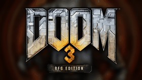

<p align="center">
  
</p>

<h1 align="center">DOOM 3 BFG Edition for PlayStation Vita/TV</h1>

<p align="center">
  <b>The whole of DOOM 3 BFG Edition on the PlayStation Vita: DOOM 3, Resurrection of Evil, The Lost Mission,
  DOOM and DOOM II with No Rest for the Living, and multiplayer over the local network and online.</b>
</p>

<p align="center">
  <a href="https://discord.gg/AaXA2N4ADt"><b>Join the Ensoclock Discord</b></a> ·
  <a href="docs/MULTIPLAYER.md">Multiplayer</a> ·
  <a href="docs/TROPHIES.md">Trophies</a> ·
  <a href="docs/PATH_OC.md">500 MHz plugin</a> ·
  <a href="docs/SUPPORT.md">Reporting a problem</a>
</p>

---

## About

`doom3bfg-vita` is a native port of DOOM 3 BFG Edition to the PlayStation Vita (and PlayStation TV), built on
[chocolate-doom3-bfg](https://github.com/klaussilveira/chocolate-doom3-bfg) - a source port that keeps the original
BFG Edition experience - and on Rinnegatamante's vitaGL.

The BFG Edition was made for consoles with 512 MB of unified memory and far stronger processors. Getting it onto a
handheld with a 444 MHz CPU (500 MHz with the bundled plugin), a 222 MHz GPU and memory split between separate pools
meant reworking most of the engine's hot paths for the Vita: the renderer's shadow volumes, skinning and culling on
NEON, streamed and compressed sound, dynamic resolution for the 3D view, texture budgets, the job system across the
Vita's cores, a hardware video player, and a test harness (hold **L + R** at the title screen) that plays through
the whole game and logs every frame.

Features:

- **Every campaign**: DOOM 3, Resurrection of Evil, The Lost Mission - plus classic DOOM, DOOM II and No Rest for the
  Living, playable from the main menu.
- **Multiplayer**: deathmatch, team deathmatch, tourney, last man standing and capture the flag, with the BFG
  Edition's maps. Play on the local network, or online with friends - no PSN, no servers to set up - and with
  bots driven by Quake III Arena's bot AI, five difficulty levels.
- **Trophies**: the full set (needs the NoTrpDrm plugin - see [Trophies](docs/TROPHIES.md)).
- **Graphics for the Vita's screen**: 2x MSAA, Toksvig normal map filtering, soft edges on alpha-tested surfaces
  and a light sharpening pass tuned for the 960x544 display ([graphics notes](docs/GRAPHICS.md)).
- **Dynamic resolution** for the 3D view (720x408 down to 544x312) with the HUD and menus always at 960x544.
- **Vita controls** throughout, touch-free.

This is version **0.9**. See the [performance notes](docs/PERFORMANCE.md) for what to expect.

## Installation

You need a PlayStation Vita or PlayStation TV with HENkaku/Ensō (or h-encore) and **your own copy of DOOM 3 BFG
Edition for PC** (Steam or GOG). The game's data is not included, and never will be.

1. **Install the VPK** (`Doom3BFG_v0.9.vpk` from the [Releases](../../releases)) with VitaShell.
2. **Copy the game data.** From the PC game's install folder, copy the `base` folder to the Vita so that it ends up
   as `ux0:data/doom3bfg/base/`. Then copy this repository's `base/renderprogs` folder into it
   (`ux0:data/doom3bfg/base/renderprogs/`).
3. **Optional, but recommended: the 500 MHz plugin.** Copy `path_oc.skprx` (from the Releases) to `ur0:tai/` and add
   `ur0:tai/path_oc.skprx` under `*KERNEL` in `ur0:tai/config.txt`, then reboot. Details: [PATH_OC.md](docs/PATH_OC.md).
4. **Optional: videos** (the in-game screens and cutscenes) - see below.
5. **Optional: trophies** - see [TROPHIES.md](docs/TROPHIES.md).

The final layout on the memory card:

```
ux0:data/doom3bfg/
├── base/
│   ├── _common.resources        (and the other *.resources / *.crc files of the PC game)
│   ├── _ordered.resources
│   ├── _sound_pc*.resources
│   ├── maps/                    (the PC game's maps folder)
│   ├── strings/                 (the PC game's language files)
│   ├── wads/                    (DOOM.WAD, DOOM2.WAD, NERVE.WAD - the classic games)
│   ├── classicmusic/            (from the PC game, if your copy has it)
│   ├── renderprogs/             (from this repository: base/renderprogs)
│   ├── video/                   (optional: the converted videos, see below)
│   ├── console.txt              (written by the game: the log)
│   └── savegame/, *.cfg, account.dat, botnav/  (written by the game)
├── vitaGL.log                   (written by the renderer: the second log)
└── ...
ur0:tai/
├── config.txt                   (taiHEN's plugin list)
├── path_oc.skprx                (optional: 500 MHz)
└── NoTrpDrm.suprx               (optional: trophies)
```

**Keep `console.txt` and `vitaGL.log`.** The game writes a detailed log of everything it does to
`ux0:data/doom3bfg/base/console.txt` (rewritten at each start), and vitaGL writes `ux0:data/vitaGL.log`. If anything
goes wrong, those two files are what lets it be fixed - see [Reporting a problem](docs/SUPPORT.md).

## Videos

The PC game's videos are Bink files, which the Vita cannot play. Convert them once on a PC with **FFmpeg**
(https://ffmpeg.org - any recent build) and the two scripts in `tools/vita` (Python 3):

```
python tools/vita/convert_video.py <path to ffmpeg> "<PC game>/base/video" <output folder>
python tools/vita/make_roq.py <path to ffmpeg> "<PC game>/base" <output base folder>
```

- `convert_video.py` turns every `.bik` into an H.264 `.mp4` sized and leveled for the Vita's hardware decoder
  (keeping the folder structure).
- `make_roq.py` makes the few `.roq` software videos for the screens that play at the same time as another one
  (the Vita's hardware decoder runs one video at a time).

Copy the results into `ux0:data/doom3bfg/base/video/` keeping the sub-folders. Without them the game runs fine;
the screens and cutscenes just show no video.

## Building

The port builds with the [VitaSDK](https://vitasdk.org) (and vitaGL, SDL2 for the Vita, OpenAL Soft and the other
libraries the VitaSDK packages provide), from Windows (MSYS2) or Linux:

```
# vitaGL (Rinnegatamante) built with GLSL support and installed into the VitaSDK
git clone https://github.com/Rinnegatamante/vitaGL && cd vitaGL
make HAVE_GLSL_SUPPORT=1 HAVE_SHADER_CACHE=1 install

# the game
cmake -B build-vita -DCMAKE_TOOLCHAIN_FILE=$VITASDK/share/vita.toolchain.cmake -DCMAKE_BUILD_TYPE=Release
cmake --build build-vita -j8
```

The result is `build-vita/Doom3BFG.vpk`. A PC build (the test bed used during the port) builds with CMake and
MinGW-w64 or GCC/Clang:
`cmake -B build-pc -DCMAKE_CXX_FLAGS="-DID_SOUND_STREAM_TEST -DID_VITA_PHYSCHECK" && cmake --build build-pc`
(the two flags turn on the Vita's sound streaming and test hooks on PC).

**About online multiplayer:** the online code (finding players over the internet, accounts and bans) is not part of
this repository, to keep it from being reverse-engineered, tampered with or probed for weaknesses. A build made from
this source plays multiplayer over the local network (and with friends added by address) only - `neo/sys/sys_net_local.cpp`
stands in for the online code. The official VPK in the Releases has online play.

The `base/renderprogs` folder holds the shaders; `tools/vita` holds the scripts used during the port (videos,
LiveArea art, the trophy pack, the test reports, the NEON tests).

## AI transparency

This project was made entirely with Anthropic's Claude Opus: the work started with Claude Opus 5, and the port was
largely polished and conceptualized into what it is now by Claude Opus 5.5 - the engine work, the Vita systems, the
optimisation, the tools and these documents - directed, tested on hardware and decided by its human author.

## Community

- Discord: **https://discord.gg/AaXA2N4ADt** (Ensoclock) - support in `#support`, ban appeals in `#appeal-bfg-bans`
- Problems: [GitHub Issues](../../issues) or `#support` - with your `console.txt` and `vitaGL.log`
  ([how](docs/SUPPORT.md))

## Credits

- **id Software** - DOOM 3, DOOM 3 BFG Edition and its GPL source release; DOOM and DOOM II; Quake III Arena, whose
  bot AI the multiplayer bots are built on (GPL).
- **Klaus Silveira** - [chocolate-doom3-bfg](https://github.com/klaussilveira/chocolate-doom3-bfg), the base of this port.
- **Robert Beckebans and the RBDOOM-3-BFG contributors** - the open source BFG engine work chocolate-doom3-bfg builds on.
- **Rinnegatamante** - vitaGL, NoTrpDrm, and so much of the Vita homebrew scene this port stands on.
- **The VitaSDK team** - the toolchain and libraries; **xyzz, Yifan Lu, Davee, Proxima, motoharu** and the HENkaku/taiHEN
  developers.
- **Electry** - PSVshell, whose overclocking method the `path_oc` plugin uses.
- **The SDL2 Vita port maintainers**, **OpenAL Soft**, **TiMidity** (classic music), **zlib**, **libjpeg**.
- **CeeJay.dk** - LumaSharpen (SweetFX), the sharpening pass's pattern.
- **Michael Toksvig** - "Mipmapping Normal Maps" (2005), the normal map filtering.

DOOM, DOOM 3 and the BFG Edition are trademarks of id Software LLC, a ZeniMax Media company. This project is not
affiliated with or endorsed by id Software, ZeniMax, Bethesda or Sony. The engine source is released under the GNU
GPL v3 with id Software's additional terms (see `COPYING.txt` and `README.txt`).
